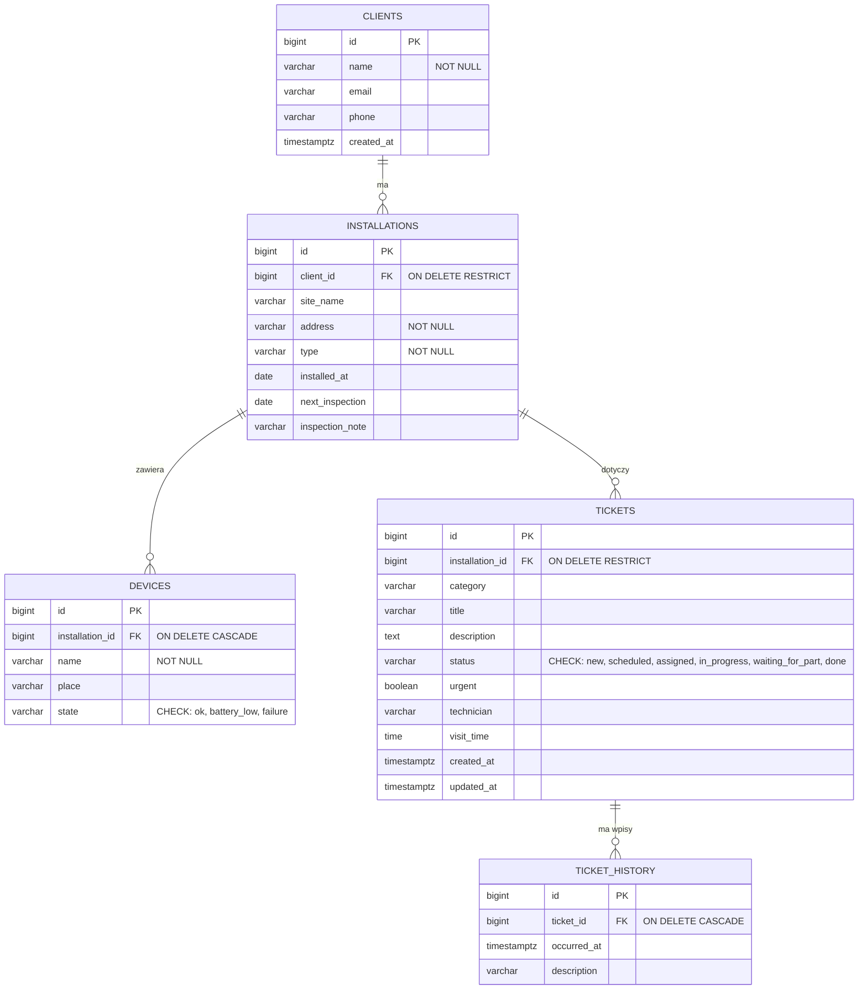

# SerwisBook

Książka serwisowa instalacji alarmowych i monitoringu wizyjnego ze zgłoszeniami serwisowymi i generatorem protokołów prac. Aplikacja jest dla małych firm instalacyjnych i ich klientów: zastępuje papierowe dokumenty, telefony i zeszyty jednym miejscem z historią instalacji, zgłoszeń i przeglądów.

## Problem i rozwiązanie

Firma instalacyjna prowadzi dokumentację w różnych miejscach: protokoły na papierze, zgłoszenia przez telefon, terminy przeglądów w pamięci. Klient nie wie, co dokładnie zamontowano u niego i kiedy jest następny przegląd. SerwisBook gromadzi karty instalacji z listą urządzeń, przyjmuje zgłoszenia usterek, pozwala technikowi wystawić protokół do wydruku lub PDF i przypomina o zbliżających się przeglądach.

Aplikacja **nie przechowuje kodów alarmowych ani haseł do urządzeń**.

## Dokumentacja

Dokumentacja będzie rozwijana w katalogu `docs/` (setup, architektura, bezpieczeństwo, testy). Prototyp ekranów jest w Figmie: https://www.figma.com/design/zVOJyYLt1UPsxbUO6L5s1k

## Funkcje

| Obszar | Co robi | Stan |
|---|---|---|
| Logowanie i role | Konta klienta, technika i administratora | szablon widoku |
| Klienci i instalacje | Karta klienta, instalacje, lista urządzeń i ich stan | szablon widoku |
| Zgłoszenia serwisowe | Zgłoszenie usterki przez klienta, przypisanie technika, statusy | szablon widoku |
| Protokół prac | Formularz i podgląd do wydruku lub zapisu jako PDF | szablon widoku |
| Przypomnienia o przeglądach | E-mail do klienta przed terminem (CRON + Mailpit) | planowane |
| Kalkulator wycen | Import cennika z CSV | rozszerzenie |
| Diagnoza usterek | Podpowiedzi z modelu językowego (Ollama) | rozszerzenie |

Widoki są przygotowane w wersji webowej i mobilnej. Dane na stronach są na razie przykładowe, bez bazy danych.

## Tech stack

| Warstwa | Technologie |
|---|---|
| Backend | PHP 8.3, własny framework MVC (routing, kontrolery, widoki) |
| Autoloading | Composer, PSR-4 |
| Serwer HTTP | Nginx + PHP-FPM |
| Baza danych | PostgreSQL 16 (pgAdmin do podglądu) |
| Frontend | HTML5, CSS (bez frameworka), czcionka IBM Plex Sans |
| Poczta deweloperska | Mailpit |
| Model językowy | Ollama |
| Konteneryzacja | Docker Compose |
| Projekt interfejsu | Figma |

## Wymagania i szybki start

Wymagane: Git i Docker Desktop (z Docker Compose).

```bash
git clone https://github.com/tobiaszsroka/wdpai-project.git
cd wdpai-project
cp .env.example .env
docker compose up --build -d
docker compose exec php composer dump-autoload
```

Polecenie `composer dump-autoload` jest potrzebne, bo katalog `vendor/` nie jest w repozytorium. Zatrzymanie: `docker compose down`.

Przy pierwszym starcie pustego wolumenu baza sama wykonuje skrypty z katalogu `database/` (schemat i dane demo).

## Konfiguracja

Ustawienia są w pliku `.env`, który powstaje z kopii `.env.example`. Plik `.env` nie trafia do repozytorium. W `.env.example` są tylko wartości przykładowe, nigdy prawdziwe sekrety.

| Zmienna | Znaczenie |
|---|---|
| `APP_PORT` | Port aplikacji na komputerze (domyślnie 8080) |
| `POSTGRES_DB`, `POSTGRES_USER`, `POSTGRES_PASSWORD` | Nazwa bazy oraz dane dostępowe do PostgreSQL |
| `POSTGRES_PORT` | Port bazy na komputerze |
| `DB_HOST`, `DB_PORT` | Host i port bazy widziane z kontenera PHP (w `docker-compose.yaml`: `db` i `5432`) |
| `MAILPIT_PORT` | Port interfejsu Mailpit |
| `PGADMIN_DEFAULT_EMAIL`, `PGADMIN_DEFAULT_PASSWORD` | Konto logowania do pgAdmin |
| `PGADMIN_PORT` | Port pgAdmin |

## Adresy usług

| Usługa | Adres |
|---|---|
| Aplikacja | http://localhost:8080 |
| Mailpit (podgląd e-maili) | http://localhost:8025 |
| pgAdmin | http://localhost:5050 |
| PostgreSQL | localhost:5432 (wg `POSTGRES_PORT`) |
| Ollama | http://localhost:11434 |

Porty zależą od wartości w `.env`.

## Zasady developmentu

- Każda zmiana powstaje na osobnym branchu i trafia do `main` przez pull request.
- Pull request łączymy opcją **Create a merge commit** (bez squash), bez force push.
- Małe, logiczne commity z prefiksem:

| Prefiks | Zastosowanie | Przykład |
|---|---|---|
| `feat` | Nowa funkcja | `feat: add registration form` |
| `fix` | Naprawa błędu | `fix: validate empty email` |
| `docs` | Dokumentacja | `docs: explain docker setup` |
| `refactor` | Zmiana struktury | `refactor: extract user repository` |
| `test` | Testy | `test: cover login validation` |
| `chore` | Konfiguracja | `chore: configure nginx` |

- Sekrety tylko w `.env`, nigdy w repozytorium.
- Kod PHP: `declare(strict_types=1)`, przestrzenie nazw zgodne z PSR-4, dane wypisywane w widokach przez `htmlspecialchars`.

## Architektura i katalogi

Aplikacja działa w układzie MVC. Wszystkie żądania trafiają do `public/index.php` (front controller), a klasa `Routing` dopasowuje adres do akcji kontrolera. Kontroler przygotowuje dane i przekazuje je do widoku przez `AppController::render()`.

```
.
├── database/               # schemat i dane demo PostgreSQL (*.sql)
├── docker/                 # Dockerfile'e: nginx, php, db
├── docker-compose.yaml     # definicja usług
├── public/                 # jedyny katalog dostępny z internetu
│   ├── index.php           # front controller i lista tras
│   ├── css/                # style
│   └── views/              # widoki (*.html.php)
│       ├── partials/       # wspólny nagłówek, stopka, menu
│       └── mobile/         # widoki mobilne
├── src/
│   ├── Routing.php         # dopasowanie tras do kontrolerów
│   ├── Container.php       # składanie zależności (kontrolery, repozytoria, PDO)
│   ├── Database.php        # połączenie PDO z PostgreSQL (konfiguracja z .env)
│   ├── controllers/        # kontrolery (przestrzeń App\Controller)
│   ├── models/             # encje i enumy (App\Model)
│   └── repositories/       # SQL i mapowanie wierszy na modele (App\Repository)
├── composer.json           # autoloading PSR-4
└── .env.example            # wzór konfiguracji
```

## Baza danych i ERD

Dane są w PostgreSQL 16. Połączenie tworzy `App\Database` na podstawie zmiennych środowiskowych, a cały SQL jest w `src/repositories/` (zapytania parametryzowane przez PDO). Kontrolery dostają repozytoria przez interfejsy, a widoki dostają obiekty z `src/models/`.



Usunięcie klienta lub instalacji z istniejącymi zgłoszeniami jest blokowane (`RESTRICT`), a urządzenia i historia znikają razem z rodzicem (`CASCADE`). Pole `technician` jest na razie tekstem. Zamieni je klucz obcy do tabeli użytkowników, gdy dojdą konta i role.

### Import bazy i dane demo

Nowy wolumen dostaje schemat i dane automatycznie. Dla istniejącej bazy (lub po `docker compose down -v`) skrypty można wykonać ręcznie:

```bash
docker compose exec -T db sh -c 'psql -U "$POSTGRES_USER" -d "$POSTGRES_DB"' < database/01-schema.sql
docker compose exec -T db sh -c 'psql -U "$POSTGRES_USER" -d "$POSTGRES_DB"' < database/02-seed.sql
docker compose exec db sh -c 'psql -U "$POSTGRES_USER" -d "$POSTGRES_DB" -c "\d tickets"'
```

Dane demo nie zawierają haseł do urządzeń ani kodów alarmowych.

## Trasy i testy

Obecnie wszystkie trasy to widoki typu GET. Parametr `{id}` przyjmuje tylko cyfry, a nieznany adres daje stronę 404.

| Widok | Adres |
|---|---|
| Strona główna | `/` |
| Instalacje (lista, szczegóły) | `/installations`, `/installations/{id}` |
| Logowanie (web, mobile) | `/login`, `/m/login` |
| Panel główny | `/dashboard` |
| Klienci i instalacje | `/clients` |
| Zgłoszenia serwisowe | `/tickets` |
| Protokół prac | `/protocols` |
| Moje zadania, szczegóły zgłoszenia (mobile) | `/m/tasks`, `/m/tasks/{id}` |
| Zgłoś usterkę (mobile) | `/m/report` |
| Karta instalacji (mobile) | `/m/installation` |

Endpointy do zapisu danych (POST) i automatyczne testy zostaną dodane w kolejnych etapach.

## Autorzy

- Tobiasz Sroka: cały projekt (koncepcja, prototyp w Figmie, backend i widoki).
